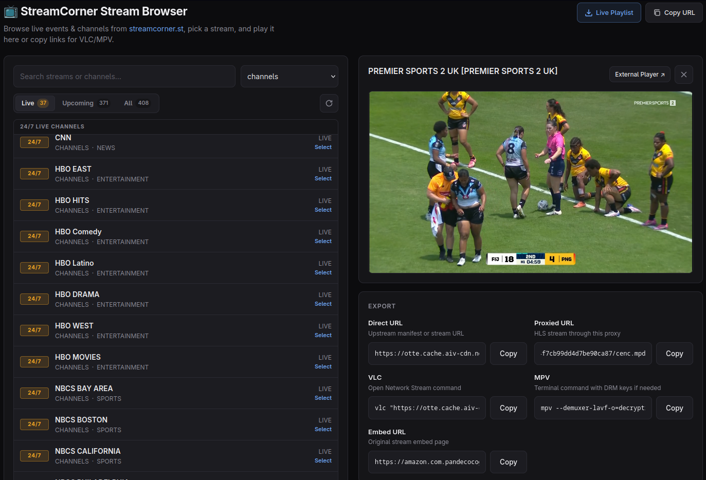

<div align="center">
  
# 📺 StreamCorner HLS Stream Resolver & Proxy

**🎬 Full-stack Node.js resolver & proxy for [streamcorner.st](https://streamcorner.st) live streams with a responsive browser-based event explorer, HLS relay, and dynamic IPTV M3U8 playlist server.**

[](https://nodejs.org/)
[](#disclaimer)
[](#-docker)
[](https://playwright.dev/)

Bridges StreamCorner's obfuscated Cloudflare Worker data mirrors, resolves stream embeds and manifests, and proxies HLS playback — all presented behind a clean, responsive web interface.

<p></p>

</div>

---

## ✨ Features

| Feature | Description |
|---|---|
| 📺 **Stream Browser UI** | Browse 24/7 channels and live events across all known providers with instant search and provider/category filtering. |
| 🎛️ **Multi-Source Selection** | Switch between alternative stream broadcasts (`STREAM 1`, `STREAM 2`, home/away feeds) per event. |
| 🟢 **Status Indicators** | `LIVE` / `24/7` / `SOON` badges with real-time counters and automatic refresh. |
| ▶️ **In-Browser Playback** | Native HLS.js streaming directly in Chrome, Firefox, Safari, and Edge, with seamless fallback for embed players. |
| 📋 **Export Commands** | One-click clipboard copy for direct manifest URLs, proxied URLs, VLC network stream commands, MPV commands, and embed URLs. |
| 📻 **Dynamic IPTV M3U8 Server** | Serves standard IPTV playlists (`GET /playlist.m3u8`) with `tvg-id`, `tvg-name`, `tvg-logo`, and `group-title` tags compatible with **TiviMate**, **VLC**, **Jellyfin**, **Kodi**, and **IPTV Smarters**. |
| ⚡ **Live Channel Relay** | On-the-fly stream resolving and chunk relaying via `/live/:provider/:id.m3u8`. |
| 🔁 **Cloudflare Worker Failover** | Automatic mirror failover across StreamCorner's 25 Cloudflare Worker endpoints with ephemeral in-memory worker RPC bridging. |
| 🚀 **High Performance Cache** | In-memory caching for listings and metadata prevents mirror rate limits and delivers sub-second page loads. |

---

## 🏗️ Architecture

### Overview

```
┌──────────────────────────────────────────────────────────────────┐
│                   Browser Interface (Port 3000)                  │
│  ┌──────────────┐   ┌───────────────┐   ┌──────────────────────┐ │
│  │ Channel List │ → │ Source Picker │ → │ In-Browser Player    │ │
│  │  + Category  │   │  (Substreams) │   │ + Export Commands    │ │
│  └──────────────┘   └───────────────┘   └──────────────────────┘ │
└──────────────────────────────────────────────────────────────────┘
                               │
                               ▼
┌──────────────────────────────────────────────────────────────────┐
│                 StreamCorner Backend Server (Node.js)            │
│   GET  /api/streams    →  aggregated channel and event listings  │
│   GET  /api/detail     →  item metadata and embed source pool    │
│   POST /api/embed      →  resolves manifest and proxied URL     │
│   GET  /api/hls        →  HLS reverse proxy with m3u8 rewrite    │
│   GET  /playlist.m3u8  →  standard IPTV M3U8 playlist server    │
│   GET  /live/:p/:id    →  on-the-fly channel relay               │
└──────────────────────────────────────────────────────────────────┘
                               │
                ┌──────────────┴──────────────┐
                ▼                             ▼
┌───────────────────────────────┐   ┌───────────────────────────────┐
│     Playwright Worker Bridge  │   │          CDN / Stream         │
│  Loads BCJZAtsV.js harness in │   │  Fetches upstream .m3u8 and   │
│  Chromium, handles encrypted  │   │  .ts/.m4s segments with CORS  │
│  RPCs to 25 CF worker mirrors │   │  and spoofed Referer/Origin   │
└───────────────────────────────┘   └───────────────────────────────┘
```

### How StreamCorner Protocol Works

The site **never** serves stream data directly from `streamcorner.st`. All data is retrieved from a pool of 25 Cloudflare Worker mirrors (`data.*.workers.dev`) via:
- `POST https://data.<mirror>.workers.dev/corner?p=<provider>` (listings)
- `POST https://data.<mirror>.workers.dev/corner?p=<provider>&id=<id>` (details)

Every request body is an encrypted binary payload built by an obfuscated worker script (`assets/BCJZAtsV.js`). This application bridges the site's own provider worker inside a managed headless Chromium environment:
1. Bootstraps worker chunks (`BCJZAtsV.js`, `TYiWbeTw.js`, `CZSRciDc.js`, `m8LErQpA.js`) to local cache.
2. Serves them on an ephemeral internal port and loads them in headless Chromium.
3. Issues `provider-list` and `provider-detail` RPCs through the worker over `postMessage`.
4. Returns clean, normalized JSON and proxies the resulting HLS streams.

This completely bypasses Cloudflare bot protection on the main site (which is never visited) and the `disable-devtool` anti-debug script.

---

## 🚀 Quick Start

### Prerequisites

- **Node.js 18+**
- **npm** or **pnpm**
- **Chromium** (installed automatically via Playwright)

### Local Installation

```bash
git clone <repo-url> app-sc
cd app-sc

# Install dependencies
npm install

# Install Playwright browser
npx playwright install chromium

# Start the server
npm start
```

Open `http://localhost:3000/` in your browser.

---

## 🐳 Docker

### Run with Docker Compose

```bash
docker compose up -d
```

### Build & Run with Docker CLI

```bash
# Build the Docker image
docker build -t streamcorner-hls-proxy .

# Run container on port 3000
docker run -d -p 3000:3000 --name streamcorner streamcorner-hls-proxy
```

---

## 📡 API Reference

### 1. `GET /api/streams`
Fetches streams and channels.

**Query Parameters:**
- `provider` *(optional)*: `channels`, `admin`, `mlb`, `nfl`, `nba`, `alpha`, `beta`, `001`, `extra003`, `slingtv`, or `all` (default: `all`).

**Response Example:**
```json
{
  "ok": true,
  "count": 20,
  "streams": [
    {
      "id": "amc",
      "provider": "channels",
      "name": "AMC",
      "category": "ENTERTAINMENT",
      "time": "LIVE",
      "poster": "https://m.media-amazon.com/...",
      "page_url": "https://streamcorner.st/stream/channels/amc",
      "uri": "channels/amc"
    }
  ]
}
```

---

### 2. `GET /api/detail`
Fetches stream detail and extracted embed URLs.

**Query Parameters:**
- `provider`: e.g. `channels`
- `id`: e.g. `amc`

**Response Example:**
```json
{
  "ok": true,
  "provider": "channels",
  "id": "amc",
  "record": { "id": "amc", "name": "AMC", "category": "ENTERTAINMENT" },
  "embeds": [
    { "source": "STREAM 1", "url": "https://amazon.com.pandecocogaming.sbs/?p=..." }
  ]
}
```

---

### 3. `POST /api/embed`
Resolves an embed URL to manifest and proxied URL.

**Request Body:**
```json
{
  "iframe": "https://amazon.com.pandecocogaming.sbs/?p=..."
}
```

**Response Example:**
```json
{
  "ok": true,
  "type": "m3u8",
  "streamUrl": "https://otte.live.fly.ww.aiv-cdn.net/...",
  "proxiedUrl": "http://localhost:3000/api/hls?url=https%3A%2F%2F...&referer=...",
  "embedUrl": "https://amazon.com.pandecocogaming.sbs/?p=..."
}
```

---

### 4. `GET /api/hls`
Reverse proxies HLS manifests and video segments, rewriting relative and absolute URIs so they flow through the proxy with proper CORS and spoofed headers.

**Query Parameters:**
- `url`: The target manifest or segment URL.
- `referer` *(optional)*: Upstream referer header.

---

### 5. `GET /playlist.m3u8`
Serves dynamic `#EXTM3U` playlist for IPTV players.

**Query Parameters:**
- `provider` *(optional)*: Filter by provider (`channels`, `admin`, `nba`, etc.)
- `category` *(optional)*: Filter by category (`SPORTS`, `NEWS`, `ENTERTAINMENT`)

**Example:**
```m3u
#EXTM3U
#EXTINF:-1 tvg-id="amc" tvg-name="AMC" tvg-logo="https://..." group-title="ENTERTAINMENT",AMC
http://localhost:3000/live/channels/amc.m3u8
#EXTINF:-1 tvg-id="cnn" tvg-name="CNN" tvg-logo="https://..." group-title="NEWS",CNN
http://localhost:3000/live/channels/cnn.m3u8
```

---

### 6. `GET /live/:provider/:id.m3u8`
Live stream on-the-fly resolver. Automatically fetches stream detail, resolves the active source, and proxies HLS.

---

## 📺 IPTV Player Setup

### TiviMate / IPTV Smarters / Jellyfin / Kodi

1. Add a new **M3U Playlist** source.
2. Enter the playlist URL:
   ```
   http://<your-server-ip>:3000/playlist.m3u8
   ```
3. *(Optional)* For 24/7 channels only:
   ```
   http://<your-server-ip>:3000/playlist.m3u8?provider=channels
   ```

---

## 💻 Terminal Playback

### VLC
```bash
vlc "http://localhost:3000/live/channels/amc.m3u8"
```

### MPV
```bash
mpv --force-media-title="AMC" "http://localhost:3000/live/channels/amc.m3u8"
```

---

## 🗂️ Project Structure

```
app-sc/
├── Dockerfile              # Production multi-stage Docker container
├── docker-compose.yml      # Docker Compose configuration
├── .env.sample             # Sample environment variables
├── .gitignore              # Git ignore rules
├── package.json            # Node.js ESM package configuration
├── scripts/
│   └── build.js            # Standalone distribution build script
├── public/                 # Frontend Web UI
│   ├── index.html          # Dual-column responsive layout
│   ├── css/
│   │   └── app.css         # Modern dark-mode styling & animations
│   └── js/
│       └── app.js          # Reactive event list, player, & export logic
├── src/                    # Backend server & proxy engine
│   ├── env.js              # Environment & configuration defaults
│   ├── server.js           # HTTP server & graceful shutdown hooks
│   ├── bridge/
│   │   ├── constants.js    # Provider registry & 25 CF worker mirrors
│   │   ├── bootstrap.js    # Automatic worker chunks downloader
│   │   └── worker.js       # Playwright worker bridge & memory cache
│   ├── resolve/
│   │   ├── stream.js       # Record normalizers & stream query routines
│   │   └── manifest.js     # Headless embed manifest sniffer
│   ├── relay/
│   │   ├── hls.js          # HLS stream and segment proxy
│   │   ├── rewrite.js      # M3U8 tag and URL rewriting engine
│   │   └── segment.js      # Video transport segment body handler
│   ├── playlist/
│   │   └── iptv.js         # IPTV M3U8 generation & on-the-fly relay
│   └── http/
│       ├── route.js        # REST routing engine
│       ├── respond.js      # JSON and stream helpers
│       └── static.js       # Public asset server
└── streamcorner.py         # Original standalone CLI utility
```

---

## ⚠️ Disclaimer

This tool is strictly for personal research, educational purposes, and interoperability analysis. All trademarks, channel names, and content belong to their respective owners. Do not use this tool to bypass DRM or violate third-party terms of service.
# streamcorner-hls-stream-resolver
# streamcorner-hls-stream-resolver
